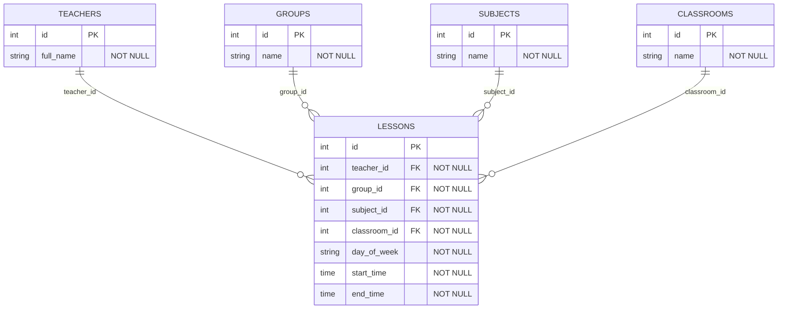

# Лабораторная работа №4. Разработка базы данных

## 1. Цель работы

Цель лабораторной работы — разработать базу данных для программы
планирования учебных занятий и расписаний.

Для работы с базой данных используются:

- SQLite — реляционная база данных;
- SQLAlchemy 2.x — библиотека для работы с базой данных через ORM;
- Alembic — инструмент управления миграциями;
- Python 3.13+ — язык программирования.

В ходе работы существующая консольная программа была адаптирована
для постоянного хранения данных вместо хранения только в памяти.

## 2. Состав базы данных

База данных содержит пять основных таблиц:

| Таблица | Назначение |
|---|---|
| `teachers` | Преподаватели |
| `groups` | Учебные группы |
| `subjects` | Учебные дисциплины |
| `classrooms` | Аудитории |
| `lessons` | Учебные занятия |

Таблица `lessons` является центральной. Каждое занятие связано
с одним преподавателем, одной учебной группой, одной дисциплиной
и одной аудиторией.

## 3. ER-диаграмма

ER-диаграмма отражает таблицы базы данных, их поля,
первичные и внешние ключи, а также связи между таблицами.



Обозначения:

- `PK` (Primary Key) — первичный ключ, уникально определяющий запись;
- `FK` (Foreign Key) — внешний ключ, ссылающийся на другую таблицу;
- `NOT NULL` — обязательное значение;
- `||--o{` — связь «один ко многим»: одной записи первой
  таблицы может соответствовать несколько записей второй.

Названия таблиц на диаграмме показаны заглавными буквами
для наглядности. В SQLite используются строчные названия.

## 4. Описание таблиц

### 4.1. Таблица teachers

Содержит сведения о преподавателях.

| Поле | Тип | Ограничения |
|---|---|---|
| `id` | INTEGER | PK, NOT NULL |
| `full_name` | VARCHAR | NOT NULL |

Один преподаватель может проводить несколько занятий.

### 4.2. Таблица groups

Содержит сведения об учебных группах.

| Поле | Тип | Ограничения |
|---|---|---|
| `id` | INTEGER | PK, NOT NULL |
| `name` | VARCHAR | NOT NULL |

У одной учебной группы может быть несколько занятий.

### 4.3. Таблица subjects

Содержит сведения об учебных дисциплинах.

| Поле | Тип | Ограничения |
|---|---|---|
| `id` | INTEGER | PK, NOT NULL |
| `name` | VARCHAR | NOT NULL |

Одна дисциплина может встречаться в нескольких занятиях.

### 4.4. Таблица classrooms

Содержит сведения об аудиториях.

| Поле | Тип | Ограничения |
|---|---|---|
| `id` | INTEGER | PK, NOT NULL |
| `name` | VARCHAR | NOT NULL |

В одной аудитории могут проводиться разные занятия.

### 4.5. Таблица lessons

Хранит информацию об учебных занятиях.

| Поле | Тип | Ограничения |
|---|---|---|
| `id` | INTEGER | PK, NOT NULL |
| `teacher_id` | INTEGER | FK, NOT NULL |
| `group_id` | INTEGER | FK, NOT NULL |
| `subject_id` | INTEGER | FK, NOT NULL |
| `classroom_id` | INTEGER | FK, NOT NULL |
| `day_of_week` | VARCHAR | NOT NULL, CHECK |
| `start_time` | TIME | NOT NULL |
| `end_time` | TIME | NOT NULL |

Внешние ключи указывают на соответствующие таблицы
преподавателей, групп, дисциплин и аудиторий.

## 5. Связи между сущностями

### 5.1. Связи «один ко многим»

В системе реализованы четыре основные связи:

1. `teachers` → `lessons`;
2. `groups` → `lessons`;
3. `subjects` → `lessons`;
4. `classrooms` → `lessons`.

Каждое занятие связано ровно с одной записью каждого
справочника. При этом запись справочника может использоваться
в нескольких занятиях.

Связи реализованы с помощью `ForeignKey`, `relationship`
и `back_populates`.

### 5.2. Связь «многие ко многим»

Между учебными группами и дисциплинами существует
связь «многие ко многим»:

- одна группа может изучать несколько дисциплин;
- одну дисциплину могут изучать несколько групп.

В текущей модели эта связь определяется через таблицу `lessons`.

Например:

- группа ИВТ-261 изучает математику и физику;
- математику изучают группы ИВТ-261 и ИВТ-262.

В SQLAlchemy связь реализована свойствами:

- `GroupORM.subjects`;
- `SubjectORM.groups`.

В них используется `secondary="lessons"`,
`back_populates` и `viewonly=True`.

`viewonly=True` означает, что связь предназначена для чтения.
Создание связи между группой и дисциплиной происходит
через создание полноценного занятия.

Отдельная таблица связи не требуется, поскольку таблица
`lessons` уже содержит соответствующие внешние ключи.

## 6. Ограничения целостности данных

### 6.1. Первичные ключи

Каждая таблица имеет первичный ключ `id`.

В консольной программе идентификаторы задаются пользователем.
Повторное добавление записи с существующим ID запрещено.

### 6.2. Внешние ключи

В таблице `lessons` используются четыре внешних ключа.

Для них задано ограничение `ON DELETE RESTRICT`.

Это запрещает удалять преподавателя, группу, дисциплину
или аудиторию, пока на соответствующую запись ссылается
хотя бы одно занятие.

В настройке SQLite включена проверка внешних ключей:

```sql
PRAGMA foreign_keys=ON;
```

### 6.3. Обязательные поля

Все поля таблиц объявлены как `NOT NULL`.

Дополнительно доменные dataclass-модели проверяют корректность
идентификаторов и непустые текстовые значения.

### 6.4. Ограничение времени

Для занятий создано ограничение:

```sql
CHECK (end_time > start_time)
```

Время окончания занятия должно быть позже времени начала.

### 6.5. Ограничение дня недели

Поле `day_of_week` хранит одно из семи значений:

`MONDAY`, `TUESDAY`, `WEDNESDAY`, `THURSDAY`,
`FRIDAY`, `SATURDAY`, `SUNDAY`.

Допустимые значения ограничены проверкой `CHECK`,
созданной для перечисления SQLAlchemy.

### 6.6. Проверка временных конфликтов

Проверка временных конфликтов выполняется
на уровне бизнес-логики приложения.

Новое занятие нельзя сохранить, если в пересекающееся время
в тот же день уже заняты:

- преподаватель;
- учебная группа;
- аудитория.

Эти проверки реализованы в `LessonConflictChain`.

Они не являются отдельными ограничениями SQL в базе данных.

## 7. ORM-модели

ORM-модели находятся в каталоге
`src/schedule_planner/database/`.

Основные файлы:

- `base.py` — общий декларативный класс `Base`;
- `catalog_models.py` — модели четырёх справочников;
- `lesson_model.py` — модель занятия;
- `connection.py` — подключение к SQLite и фабрика сессий;
- `catalog_mappers.py` — преобразование справочных сущностей;
- `lesson_mapper.py` — преобразование занятий;
- `catalog_repository.py` — SQLAlchemy-репозитории справочников;
- `lesson_repository.py` — SQLAlchemy-репозиторий занятий.

В ORM-моделях используются `Mapped`, `mapped_column`
и `relationship`.

Мапперы преобразуют обычные dataclass-объекты
в SQLAlchemy-модели и обратно.

Репозитории выполняют операции добавления, чтения,
изменения и удаления записей через SQLAlchemy Session.

При успешном изменении выполняется `commit()`.
При ошибках целостности данные не сохраняются,
выполняется `rollback()`, а приложение получает исключение.

## 8. Миграции Alembic

Для создания и изменения структуры базы данных используется
Alembic.

Инициализация Alembic была выполнена командой:

```powershell
uv run alembic init alembic
```

Первая миграция создана с помощью:

```powershell
uv run alembic revision --autogenerate -m "create initial schedule tables"
```

Файл миграции:

`alembic/versions/a1b1cc4511b0_create_initial_schedule_tables.py`

Миграция создаёт пять таблиц и ограничения целостности.

Для применения миграций:

```powershell
uv run alembic upgrade head
```

Для просмотра текущей ревизии:

```powershell
uv run alembic current
```

Для проверки различий между ORM-моделями и схемой базы:

```powershell
uv run alembic check
```

Текущая ревизия:

`a1b1cc4511b0`

Структура таблиц создаётся через Alembic.
Вызов `Base.metadata.create_all()` не используется.

## 9. Запуск программы

### 9.1. Установка зависимостей

Необходимо использовать Python 3.13 или новее
и менеджер проектов `uv`.

В корневой папке репозитория:

```powershell
uv sync
```

### 9.2. Подготовка базы данных

Перед первым запуском:

```powershell
uv run alembic upgrade head
```

### 9.3. Запуск консольного приложения

```powershell
uv run python src/main.py
```

Альтернативный вариант:

```powershell
uv run schedule-planner
```

Консольное приложение использует SQLite.

Файл базы данных:

`instance/schedule_planner.db`

Папка `instance/` исключена из Git,
поэтому локальные данные не отправляются в репозиторий.

Сохранённые записи остаются доступными после закрытия
и повторного запуска программы.

## 10. Проверка работы

Для запуска автоматизированных тестов:

```powershell
uv run python -m unittest discover -s tests -v
```

Для проверки Ruff:

```powershell
uv run ruff check .
uv run ruff format --check .
```

Тесты охватывают:

- создание и проверку моделей;
- операции со справочниками;
- операции с занятиями;
- преобразование dataclass и ORM;
- сохранение и загрузку данных из SQLite;
- защиту связанных записей от удаления;
- связь групп и дисциплин «многие ко многим»;
- проверку временных конфликтов;
- сохранение данных между запусками CLI.

Интеграционные тесты используют отдельную базу SQLite
в памяти и создают таблицы через миграцию Alembic.

Рабочий файл базы данных при этих тестах не изменяется.

## 11. Результат работы

В рамках лабораторной работы реализована реляционная
база данных для планирования учебного расписания.

Разработаны пять таблиц, настроены первичные и внешние
ключи, ограничения целостности и связи между сущностями.

Реализованы SQLAlchemy ORM-модели, мапперы,
репозитории и миграция Alembic.

Консольное приложение переведено на постоянное хранение
данных в SQLite.

Существующая бизнес-логика расписания и терминальный
интерфейс продолжают работать с новыми репозиториями.

Веб-интерфейс, REST API и контейнерное развертывание
относятся к последующим этапам разработки проекта.
