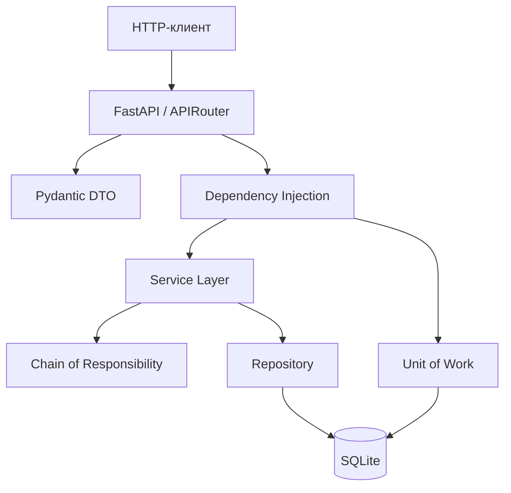

# Лабораторная работа №5 — REST API

## 1. Назначение

REST API предназначен для управления учебным расписанием
и справочными данными через HTTP-запросы.

Для реализации API используется FastAPI,
для валидации и сериализации данных — Pydantic,
для хранения данных — SQLite и SQLAlchemy.

## 2. Архитектура приложения



Основные компоненты:

- `api.py` — приложение FastAPI;
- `routers/` — маршрутизаторы REST API;
- `dependencies.py` — внедрение зависимостей;
- `dtos/requests.py` — модели входящих данных;
- `dtos/responses.py` — модели исходящих данных;
- `catalog_service.py` — управление справочниками;
- `schedule_service.py` — управление расписанием;
- `conflicts.py` — проверка временных конфликтов;
- `database/` — работа с базой данных.

## 3. Маршруты REST API

### 3.1. Преподаватели

| Метод | Маршрут | Назначение |
|---|---|---|
| GET | `/teachers` | Получение списка |
| GET | `/teachers/{teacher_id}` | Получение преподавателя |
| POST | `/teachers` | Создание преподавателя |
| PUT | `/teachers/{teacher_id}` | Изменение преподавателя |
| DELETE | `/teachers/{teacher_id}` | Удаление преподавателя |

### 3.2. Учебные группы

| Метод | Маршрут | Назначение |
|---|---|---|
| GET | `/groups` | Получение списка |
| GET | `/groups/{group_id}` | Получение группы |
| POST | `/groups` | Создание группы |
| PUT | `/groups/{group_id}` | Изменение группы |
| DELETE | `/groups/{group_id}` | Удаление группы |

### 3.3. Дисциплины

| Метод | Маршрут | Назначение |
|---|---|---|
| GET | `/subjects` | Получение списка |
| GET | `/subjects/{subject_id}` | Получение дисциплины |
| POST | `/subjects` | Создание дисциплины |
| PUT | `/subjects/{subject_id}` | Изменение дисциплины |
| DELETE | `/subjects/{subject_id}` | Удаление дисциплины |

### 3.4. Аудитории

| Метод | Маршрут | Назначение |
|---|---|---|
| GET | `/classrooms` | Получение списка |
| GET | `/classrooms/{classroom_id}` | Получение аудитории |
| POST | `/classrooms` | Создание аудитории |
| PUT | `/classrooms/{classroom_id}` | Изменение аудитории |
| DELETE | `/classrooms/{classroom_id}` | Удаление аудитории |

### 3.5. Учебные занятия

| Метод | Маршрут | Назначение |
|---|---|---|
| GET | `/lessons` | Получение расписания |
| GET | `/lessons/{lesson_id}` | Получение занятия |
| POST | `/lessons` | Создание занятия |
| PUT | `/lessons/{lesson_id}` | Изменение занятия |
| DELETE | `/lessons/{lesson_id}` | Удаление занятия |

### 3.6. Системные маршруты

| Метод | Маршрут | Назначение |
|---|---|---|
| GET | `/health` | Проверка доступности API |

## 4. Модели передачи данных

Для входящих и исходящих данных используются
отдельные Pydantic DTO.

Входящие DTO обеспечивают проверку идентификаторов,
обязательных текстовых полей и времени занятий.

Исходящие DTO определяют структуру HTTP-ответов.

### 4.1. Пример создания преподавателя

POST `/teachers`

```json
{
    "id": 1,
    "full_name": "Иванов Иван Иванович"
}
```

### 4.2. Пример создания занятия

POST `/lessons`

```json
{
    "id": 1,
    "teacher_id": 1,
    "group_id": 1,
    "subject_id": 1,
    "classroom_id": 1,
    "day_of_week": "Понедельник",
    "start_time": "09:00:00",
    "end_time": "10:30:00"
}
```

Перед созданием занятия связанные справочные записи
должны существовать в базе данных.

### 4.3. Пример ответа

```json
{
    "id": 1,
    "teacher": {
        "id": 1,
        "full_name": "Иванов Иван Иванович"
    },
    "group": {
        "id": 1,
        "name": "ИВТ-21"
    },
    "subject": {
        "id": 1,
        "name": "Математика"
    },
    "classroom": {
        "id": 1,
        "name": "305"
    },
    "day_of_week": "Понедельник",
    "start_time": "09:00:00",
    "end_time": "10:30:00"
}
```

## 5. Фильтрация расписания

Маршрут GET `/lessons` поддерживает следующие параметры:

| Параметр | Назначение |
|---|---|
| `teacher_id` | Фильтрация по преподавателю |
| `group_id` | Фильтрация по учебной группе |
| `classroom_id` | Фильтрация по аудитории |
| `day_of_week` | Фильтрация по дню недели |

Допускается одновременное использование нескольких
параметров фильтрации.

Пример:

`GET /lessons?teacher_id=1&group_id=1`

## 6. Обработка ошибок

| HTTP-код | Назначение |
|---|---|
| 200 | Успешное получение или изменение данных |
| 201 | Успешное создание записи |
| 204 | Успешное удаление записи |
| 400 | Несовпадение идентификаторов |
| 404 | Сущность не найдена |
| 409 | Конфликт данных или расписания |
| 422 | Ошибка валидации входящих данных |

При возникновении временного конфликта занятие
не сохраняется.

Удаление справочной записи, используемой в существующем
занятии, не допускается.

## 7. Паттерны проектирования

### 7.1. Chain of Responsibility

Используется для последовательной проверки конфликтов
преподавателей, учебных групп и аудиторий.

### 7.2. Repository

Отделяет бизнес-логику приложения
от реализации хранения данных.

### 7.3. Service Layer

Содержит правила управления справочниками
и учебным расписанием.

Маршрутизаторы FastAPI используют существующие сервисы.

### 7.4. Unit of Work

Обеспечивает управление транзакциями
при выполнении операций с базой данных.

Изменения сохраняются после успешного выполнения
операции. Незавершённые изменения откатываются.

### 7.5. Dependency Injection

Зависимости передаются через механизм Depends
библиотеки FastAPI.

Это позволяет подменять рабочие зависимости
тестовыми реализациями.

## 8. Автоматическая документация

FastAPI предоставляет следующие маршруты документации:

- `/docs` — Swagger UI;
- `/redoc` — ReDoc;
- `/openapi.json` — спецификация OpenAPI.

Документация доступна после запуска веб-сервера.

## 9. Автоматизированное тестирование

Интеграционные тесты выполняются через TestClient
с использованием изолированной базы SQLite.

Запуск интеграционных тестов:

```powershell
uv run python -m unittest discover -s tests -p "test_api_*.py" -v
```

Запуск всех тестов:

```powershell
uv run python -m unittest discover -s tests
```

Проверка качества кода:

```powershell
uv run ruff check .
uv run ruff format --check .
```

На этапе реализации REST API успешно пройдено
197 тестов, включая 74 интеграционных теста API.

## 10. Ограничения текущего этапа

Авторизация и разграничение прав доступа
на уровне REST API пока не реализованы.

Веб-интерфейс Jinja2 и единая точка запуска
будут реализованы на следующих этапах разработки.
